### `> about`

🛰️ <samp>OSINT & Cyber Threat Intelligence: I analyse the digital exposure of organisations across Surface, Deep and Dark Web, from the digital perimeter and known vulnerabilities to leaked credentials, phishing domains and indicators of compromise.</samp>

🐍 <samp>I write Python scripts to automate collection, correlation and leak hunting, and turn raw findings into clear, verifiable evidence.</samp>

🎓 <samp>Master's and Bachelor's Degree in Computer Science at the University of Salerno, with a focus on Cloud Computing.</samp>

📚 <samp>Deepening my knowledge in Cloud Technologies and IT Security to stay up-to-date and tackle complex challenges.</samp>

🛡️ <samp>Passionate about Cybersecurity, Cloud Security and Open Source Intelligence.</samp>

### `> focus --areas`

| | Area | What I do |
|:-:|---|---|
| 🛰️ | **OSINT & CTI** | Attack surface mapping, domain and DNS intelligence, leaked credentials on Deep and Dark Web, typosquatting detection, IoC enrichment |
| 🐍 | **Programming & data** | Python tooling for collection and analysis, data pipelines with MongoDB, computer vision with OpenCV, web and mobile apps |
| ☁️ | **Cloud & parallel computing** | Serverless apps on Azure, MPI simulations benchmarked on Google Cloud clusters |

### `> ls toolkit/`

<code>osint · intel</code> 

<code>languages · data</code> 

<code>frameworks · libraries</code> 

<code>tools · ides</code> 

<code>cloud · os</code> 

### `> cat projects.log`

| Project | Domain | Notes |
|---|---|---|
| [**Twitter Sentiment Analysis · Covid-19**](https://github.com/Francesco-Parisi/Twitter-Sentiment-Analysis-during-Covid-19) | `open sources · social media analysis` | Weekly trending hashtags via Twitter API, MongoDB, VADER sentiment, web dashboard |
| [**Pose Recognition for Human Interaction**](https://github.com/Francesco-Parisi/Pose-Recognition-for-Human-interaction-in-Videogames) | `computer vision` | 68 facial landmarks (FAN) streamed over TCP to Unity for near real-time head orientation |
| [**MyHealthcareBot**](https://github.com/Francesco-Parisi/MyHealthcareBot) | `cloud · serverless` | Azure Bot Service, Functions, Logic App, LUIS, Cosmos DB |
| [**Schelling model of segregation**](https://github.com/Francesco-Parisi/Schelling-model-of-segregation) | `parallel computing` | MPI simulation benchmarked on a 24 vCPU Google Cloud cluster |
| [**Luxer Assistant**](https://github.com/Francesco-Parisi/Emad2021_Luxer-Assistant) | `mobile · fashion & luxury` | Clienteling app: purchase history, cross-selling, QR search, AR preview |
| [**MPI_Allgather Optimization**](https://github.com/Francesco-Parisi/MPI_Allgather-Optimization) | `high performance computing` | Ring, Recursive Doubling and Recursive Halving vs native Allgather |

### `> stats --live`

<picture>
  <source media="(prefers-color-scheme: dark)" srcset="https://raw.githubusercontent.com/Francesco-Parisi/Francesco-Parisi/output/github-snake-dark.svg">
  <source media="(prefers-color-scheme: light)" srcset="https://raw.githubusercontent.com/Francesco-Parisi/Francesco-Parisi/output/github-snake.svg">
  
</picture>

<code>collect › validate › correlate › intel</code>

  
  

